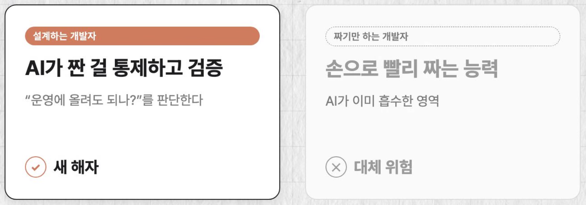
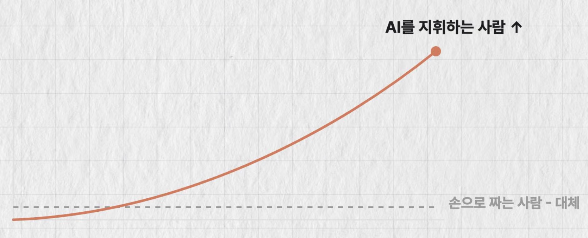

## AI 시대, 개발자의 진짜 실력은 코딩이 아니었습니다. (유튜브)
[참고 링크](https://www.youtube.com/watch?v=FroSGe2K2EY&t=1s)
`썸네일도 해당 썸네일을 참고한 2차 창작물입니다.`

> 과거시절, 내가 밤새워 짠 코드. 비전공자가 1분만에 AI를 써서 개발한다.

맞말. 대학교 시절, 코딩 동아리 시절에서 배운 코딩 능력은 이제 8할정도  
AI가 짜주는 시대입니다.

### 그럼 개발자의 진짜 실력은 뭘까?
'코드를 손으로 짜는 일'은 AI가 흡수 중  

예를들면  
`보일러 플레이트' 코드 (묻따않 공통적으로 들어가야 하는 코드)는 이미 훨씬 빠르게 작성 가능.
```tsx
import React from 'react';
import { Text, StyleSheet, View } from 'react-native';

// Component
const Home = () => {
..
```

### 남는 건 두 가지
- 무엇을, 왜 만들지 정하는 일 - **문제 정의**
- 그 분야를 진짜로 아는 것 - **도메인 지식**

### 로그인 만들어줘 - 만들어는 준다
- 어떤 복잡한 과정을 수행해야 하는지
- 어떤 예외를 반드시 막아야 하는지
- 옆 팀 시스템에 뭘 이르키는지

AI는 모른다. 물어본 사람(지시한 팀장, 본인, 클라이언트)만 안다.  

**`즉, 실력의 축 이동`**
### 얼마나 잘 짜느냐 -> 무엇을 왜, 어떻게 만들지 정의하느냐냐

🙋🏻 : 대리님 근데요. 그건 원래 중요했는데요?  
💁🏾 : ? 맞말. 달라진건 그게 중요하냐 마냐가 아니라 '비중' 임.

예전엔 개발자 실력이라고 하면  
**`구현 8`** : **문제정의 2**  

그런데 AI가 구현 8을 흡수. 남는 2가 전부가 된다.  
(내가 안함)**`구현 8`** : (내가 해야됨)**`문제정의 2`**

> 도메인 지식, 정의 능력이 필요한 비중이 올라간다.

### 비개발자가 만든 개발 문제 (도메인 정의를 잘 안한)
- 스케일이 안나옴
- 유지보수 다시 해야됨
- 나중에 무너질 가능성 높음

개발자의 필요성을 더 강조해줌.  

### 개발자가 어디 서야 하는지 알려준다.


- AI가 짠 코드 그대로 올리면 터진다
- 통제하고/설계하고/검증하는 일 -> 개발 코드 결과, 테스트, 정의 모르면 못함
- 그대로 운영에 반영 가능한가? 를 판단. 


### 코딩과 도메인 지식을 안다면 개발자가 대체 X, 격상 O

손으로 짜는 사람에서 AI를 지휘하는 사람이 된다.

### AI를 지휘하는 사람의 조건
- 뭘 시켜야하는지
- 어떻게 시켜야 안 터지는지
- 결과물이 진짜 맞는지 판단

이게 진짜 도메인 알고, 문제 정의할 줄 아는 개발자다.

### 그럼 어떻게 잘 지휘해?
지휘 = 판을 설계하는 것  

그냥 헤달라고 하는게 아닌. AI가 잘 짜도록 판을 설계하는 것.

해줘 하고 던지기 -> 판을 설계한다 (하네스)